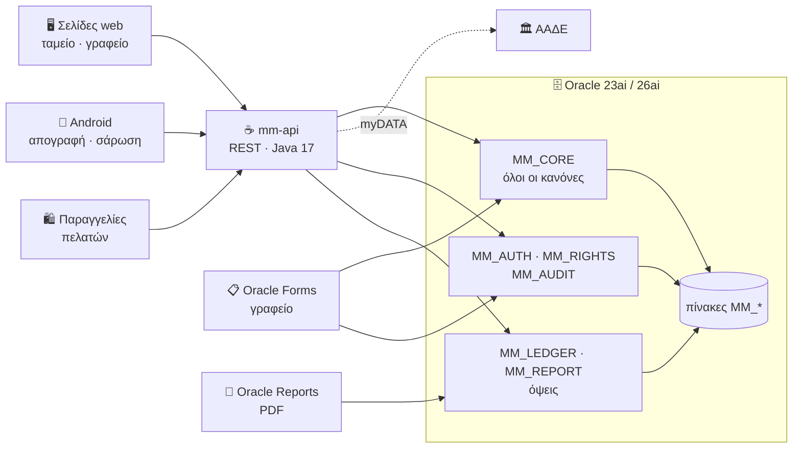

<div align="center">

# 🛒 Mini market

**Εφαρμογή για μικρά σούπερ μάρκετ και καταστήματα λιανικής, πάνω σε Oracle**

Ταμείο · Γραφείο · Αποθήκες · Τιμολόγηση · myDATA · Αναφορές · Android


</div>

---

Είδη, πελάτες, προμηθευτές, αγορές και πωλήσεις, απόθεμα σε πολλές αποθήκες με κόστος FIFO, ΦΠΑ, ταμείο με Ζ, τιμολόγια με αποστολή στο myDATA, καρτέλες και αναφορές. Όλα τρέχουν πάνω σε **μία** βάση Oracle, με **έναν** πυρήνα κανόνων σε PL/SQL.

> **Η βασική ιδέα:** κάθε κανόνας ζει μία φορά, στη βάση. Οι σελίδες web, οι φόρμες, τα reports και το κινητό καλούν τις ίδιες διαδικασίες. Έτσι δίνουν τα ίδια νούμερα και κάνουν τους ίδιους ελέγχους, όπως κι αν μπει κανείς.

## ✨ Τι κάνει

| | |
|---|---|
| 🧾 **Ταμείο** | Απόδειξη με σάρωση barcode και QR, μετρητά και κάρτα, άνοιγμα και κλείσιμο Ζ. Κουμπιά για τα είδη χωρίς barcode (καφέδες, χυμοί, γλυκά) σε ομάδες με χρώμα, και σύντομοι κωδικοί (PLU). Προσφορές αυτόματα (έκπτωση %, N+M δώρο, πακέτο σε τιμή), πόντοι πελατών, κάρτες κινητής με κρυπτογραφημένο PIN, ο ταμίας στην απόδειξη. |
| 📦 **Απόθεμα** | Κεντρική αποθήκη και υποκαταστήματα, κάθε ταμείο με τη δική του. Κόστος FIFO ανά στρώση, ενδοδιακίνηση στο κόστος, αναλώσεις (χρήση, φθορά, δείγμα, λήξη), ημερομηνίες λήξης ανά παρτίδα, ελάχιστο απόθεμα, απογραφή από το κινητό. |
| 🏷️ **Είδη** | Παραλλαγές (χρώμα × μέγεθος), καλάθια και σετ με συναρμολόγηση, serial numbers, κρατήσεις με προκαταβολή (π.χ. βασιλόπιτες), ετικέτες με barcode και QR. |
| 💼 **Γραφείο** | Τιμολόγια και πιστωτικά πώλησης και αγοράς, δελτία αποστολής, εισπράξεις και πληρωμές, παραγγελίες πελατών (και από σελίδα για τους ίδιους τους πελάτες). |
| 🏛️ **myDATA** | Αποστολή των παραστατικών στην ΑΑΔΕ, με ουρά: όσα περιμένουν φεύγουν αυτόματα κάθε λεπτό. |
| 📊 **Αναφορές** | Καρτέλες είδους, πελάτη και προμηθευτή, ισοζύγια, πωλήσεις ανά αποθήκη, ταμείο και ταμία, ΦΠΑ, αναλώσεις, σύνοψη ημέρας, γραφήματα. Στην οθόνη και σε PDF (Oracle Reports). |
| 🔐 **Ασφάλεια** | Χρήστες με PBKDF2, κλείδωμα μετά από 5 λάθη, ρόλοι με δικαιώματα ανά οθόνη, πεδίο και ενέργεια, μενού από τη βάση, έλεγχος σε κάθε κλήση στον server, ιστορικό κάθε αλλαγής (ποιος, πότε, τι). |
| ✅ **Έλεγχος** | Η όψη `MM_CHECK` είναι άδεια όταν όλα συμφωνούν: απόθεμα, σύνολα, Ζ, μετρητά, FIFO, πόντοι, αρίθμηση. |

## 🏗️ Αρχιτεκτονική



Η πλήρης περιγραφή είναι στο **[docs/ARXITEKTONIKI.md](docs/ARXITEKTONIKI.md)**: οι αρχές της βάσης, τα δικαιώματα, το mm-api, οι σελίδες, οι φόρμες, τα reports, τα tests.

## 🚀 Γρήγορη εκκίνηση

**1. Η βάση** (Oracle 23ai Free ή νεότερη):

```bash
cd db
sqlplus system@FREEPDB1 @CREATE_USER.sql        # ο χρήστης MM
export NLS_LANG=GREEK_GREECE.AL32UTF8            # Windows: set NLS_LANG=...
sqlplus mm@FREEPDB1 @INSTALL.sql demo            # πίνακες, πακέτα και δεδομένα επίδειξης
```

**2. Η υπηρεσία και οι σελίδες web** (Java 17):

```bash
cd api
./mvnw -q package -DskipTests                    # → target/mm-api.jar
java -jar target/mm-api.jar                      # http://localhost:8090
```

Η σύνδεση με τη βάση γίνεται με wallet, χωρίς κωδικό σε αρχείο. Στα Windows η υπηρεσία μπαίνει με το `install_service.ps1`, και υπάρχει και `Dockerfile`. Λεπτομέρειες στο [ODIGIES_REST.md](docs/ODIGIES_REST.md).

**3. Φόρμες και reports** (Oracle Forms & Reports 14): `forms/build_forms.ps1` και `reports/build_reports.ps1`.

**4. Android:** `mobile/build_apk.ps1` → APK.

**Μετά από κάθε ενημέρωση**, όλες οι εντολές μαζί (backup, βάση, mm-api, φόρμες, reports) είναι στο [ODIGIES_ENIMEROSI.md](docs/ODIGIES_ENIMEROSI.md).

## 📚 Τεκμηρίωση

| Έγγραφο | Τι έχει |
|---|---|
| [ARXITEKTONIKI.md](docs/ARXITEKTONIKI.md) | Πώς είναι φτιαγμένη η εφαρμογή και γιατί. |
| [ANAFORA_VASIS.md](docs/ANAFORA_VASIS.md) | **Η βάση:** κάθε πίνακας (στήλες, κλειδιά, έλεγχοι), οι όψεις, τα πακέτα, τα triggers, τα είδη παραστατικών, όλα τα λάθη `MM-1xx`. Φτιάχνεται από τη βάση. |
| [ANAFORA_EFARMOGIS.md](docs/ANAFORA_EFARMOGIS.md) | **Η εφαρμογή:** κάθε οθόνη (σελίδα και φόρμα, πεδία, ενέργειες, δικαιώματα), κάθε κλήση REST, οι φόρμες, τα reports, τα tests. Φτιάχνεται από τον κώδικα. |
| [ODIGIES_VASI.md](docs/ODIGIES_VASI.md) | Εγκατάσταση, backup, δεδομένα επίδειξης, και πώς δουλεύει κάθε λειτουργία της βάσης. |
| [ODIGIES_REST.md](docs/ODIGIES_REST.md) | Η υπηρεσία mm-api: εγκατάσταση, wallet, ρυθμίσεις, myDATA. |
| [ODIGIES_WEB.md](docs/ODIGIES_WEB.md) | Οι σελίδες web, μία προς μία. |
| [ODIGIES_FORMS.md](docs/ODIGIES_FORMS.md) | Οι φόρμες: πώς φτιάχνονται και πώς τρέχουν. |
| [ODIGIES_REPORTS.md](docs/ODIGIES_REPORTS.md) | Τα reports και ο Reports Server. |
| [ODIGIES_ANDROID.md](docs/ODIGIES_ANDROID.md) | Η εφαρμογή Android. |
| [ODIGIES_ENIMEROSI.md](docs/ODIGIES_ENIMEROSI.md) | Οι εντολές μετά από κάθε merge. |

Οι δύο αναφορές ξαναφτιάχνονται με `MM_DSN=mm/<κωδικός>@host:1521/FREEPDB1 python tools/mkdocs.py`.

## 🗂️ Δομή

```
mini-market/
├── db/          η βάση: πίνακες, MM_CORE και τα άλλα πακέτα, INSTALL, demo, backup
├── api/         mm-api (Java 17): REST, myDATA, και οι σελίδες web (src/main/resources/web)
├── forms/       Oracle Forms: mkforms.py → MM_*.xml, το κοινό πακέτο MM_UI.pls
├── reports/     Oracle Reports: mkreports.py → XML → .rdf
├── mobile/      Android (Capacitor) με σάρωση barcode και QR
├── tests/       pytest και Playwright, πάνω σε ζωντανή βάση
├── tools/       mkdocs.py: η γεννήτρια των αναφορών
└── docs/        η τεκμηρίωση
```

## 🧪 Tests

Τα tests τρέχουν πάνω σε πραγματική βάση, χωρίς mocks: τα πακέτα, το REST (με ψεύτικο server της ΑΑΔΕ), τις σελίδες σε Chromium, και τη λογική των φορμών, μεταγλωττισμένη μέσα στη βάση.

```bash
pip install pytest oracledb
(cd api && ./mvnw -q package -DskipTests)
MM_DSN=mm/<κωδικός>@localhost:1521/FREEPDB1 python -m pytest -q tests
```

Τα δεδομένα των tests ξεκινούν με `TST` και σβήνονται στο τέλος. Κάθε test τελειώνει με το `MM_CHECK` άδειο.

---

<div align="center">
<sub>Ιδιωτικό έργο · Οι βιβλιοθήκες τρίτων στο <a href="THIRD_PARTY_NOTICES.md">THIRD_PARTY_NOTICES.md</a></sub>
</div>
