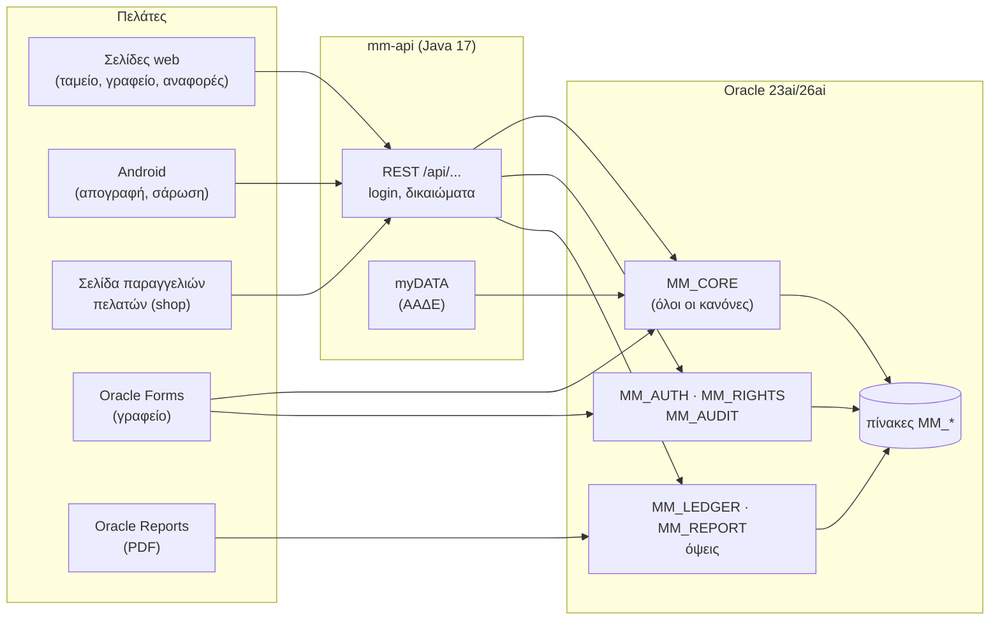

# Η αρχιτεκτονική του mini market

Πώς είναι φτιαγμένη η εφαρμογή, γιατί έτσι, και πού βρίσκεται το κάθε κομμάτι. Οι λεπτομέρειες είναι σε δύο αναφορές που φτιάχνονται αυτόματα από τον κώδικα:

- **[ANAFORA_VASIS.md](ANAFORA_VASIS.md):** κάθε πίνακας με τις στήλες, τα κλειδιά και τους ελέγχους του, οι όψεις, τα πακέτα (η προδιαγραφή τους), τα triggers, τα είδη παραστατικών, όλα τα λάθη `MM-1xx`.
- **[ANAFORA_EFARMOGIS.md](ANAFORA_EFARMOGIS.md):** κάθε κλήση του REST, οι οθόνες του μενού με τα πεδία, τις ενέργειες και τα δικαιώματά τους, οι φόρμες, τα reports, τα tests.

## 1. Η εικόνα



**Ο βασικός κανόνας:** κάθε κανόνας της δουλειάς ζει **μία φορά**, στη βάση, στο πακέτο `MM_CORE`. Αυτό ισχύει για τον αριθμό ενός παραστατικού, το απόθεμα, το κόστος FIFO, τον ΦΠΑ, το Ζ, τις προσφορές, τα serials, τις μεταφορές. Οι φόρμες, οι σελίδες web, το κινητό και τα scripts καλούν τις ίδιες διαδικασίες, άρα συμπεριφέρονται ίδια. Ένα λάθος διορθώνεται σε ένα σημείο, και ένα test στη βάση τα ελέγχει όλα.

## 2. Η βάση (`db/`)

| Αρχείο | Τι έχει |
|---|---|
| `MM_TABLES.sql` | Οι πίνακες, οι δείκτες, οι όψεις του αποθέματος και ο έλεγχος `MM_CHECK`. Τρέχει όσες φορές χρειαστεί: ό,τι υπάρχει μένει, ό,τι λείπει προστίθεται (`create table if not exists`, `add_col`). |
| `MM_BASE.sql` | Τα σταθερά δεδομένα: ΦΠΑ, είδη παραστατικών. |
| `MM_CORE.sql` | Ο πυρήνας. |
| `MM_PIN.sql` | Η κρυπτογράφηση των PIN των καρτών κινητής (AES-256, `DBMS_CRYPTO`). |
| `MM_LEDGER.sql`, `MM_REPORT.sql`, `MM_MONTHS.sql` | Καρτέλες, ισοζύγια, αναφορές, τα σύνολα των μηνών. |
| `MM_AUTH.sql`, `MM_RIGHTS.sql`, `MM_AUDIT.sql` | Χρήστες, ρόλοι και δικαιώματα, ιστορικό ενεργειών. |
| `MM_TEXT.sql` | Τα ελληνικά των φορμών (το φτιάχνει το `forms/mkforms.py`). |
| `INSTALL.sql`, `UNINSTALL.sql` | Η εγκατάσταση και η αφαίρεση. Το `INSTALL.sql demo` φορτώνει και δεδομένα επίδειξης. |
| `MM_DEMO*.sql` | Δεδομένα επίδειξης: ένας χρόνος πωλήσεων, FIFO, υποκαταστήματα, χρήστες. |
| `backup.ps1` | Το νυχτερινό backup (Data Pump) και η επαναφορά. |

Οι αρχές της βάσης:

- **Κανένα commit στα πακέτα:** τα πακέτα δεν κάνουν ποτέ commit. Το κάνει αυτός που καλεί: η φόρμα, το REST, το script. Ένα λάθος στη μέση γυρίζει πίσω όλη την ενέργεια.
- **Τα λάθη:** κάθε κανόνας που δεν τηρείται σταματά με `MM-1xx` και ελληνικό μήνυμα. Οι φόρμες και οι σελίδες το δείχνουν όπως είναι.
- **Το απόθεμα:**
  - κάθε αλλαγή του είναι μια γραμμή στο `MM_STOCK_MOVE`, με την αποθήκη της· το `MM_ITEM.STOCK` είναι το άθροισμά τους·
  - το `MM_ITEM.STOCK` είναι `RESERVABLE`, οπότε δύο ταμεία που πουλούν το ίδιο είδος δεν περιμένουν το ένα το άλλο.
- **Το κόστος (FIFO):**
  - κάθε είσοδος στο απόθεμα είναι μια στρώση (`MM_FIFO`), με το κόστος και την ημερομηνία λήξης της·
  - κάθε έξοδος παίρνει από τις παλιότερες στρώσεις (`MM_FIFO_OUT`)·
  - η ενδοδιακίνηση μεταφέρει τις στρώσεις όπως είναι, οπότε το υποκατάστημα πουλά στο κόστος του κεντρικού·
  - το `fifo_rebuild` τα ξαναβγάζει όλα από τις κινήσεις.
- **Οι αποθήκες:**
  - μία κεντρική και όσα υποκαταστήματα χρειαστούν· κάθε ταμείο πουλά από τη δική του αποθήκη·
  - η ενδοδιακίνηση (`DEN`) γίνεται στο κόστος, και η ανάλωση (`DAN`) βγάζει είδη χωρίς πώληση.
- **Ο έλεγχος:** η όψη `MM_CHECK` είναι άδεια όταν όλα συμφωνούν. Ελέγχει το απόθεμα, τα σύνολα των παραστατικών, τα Ζ, τα μετρητά, τα serials, το FIFO ανά αποθήκη, τους πόντους, την αρίθμηση και τους μήνες. Τη χρησιμοποιούν τα tests και το `MM_CHECK.sql`.
- **Ποιος έκανε τι:** τα triggers του `MM_AUDIT` γράφουν το ιστορικό, και κάθε παραστατικό κρατά ποιος το έφτιαξε και ποιος το καταχώρισε. Ο χρήστης έρχεται από το `CLIENT_IDENTIFIER` της συνεδρίας, που το βάζουν το mm-api και οι φόρμες.

## 3. Χρήστες, ρόλοι, δικαιώματα

- **Οι χρήστες (`MM_AUTH`):** ο κωδικός φυλάσσεται μόνο ως PBKDF2-HMAC-SHA256, με δικό του salt. Το token φυλάσσεται μόνο ως SHA-256. Μετά από 5 λάθη στη σειρά, ο λογαριασμός κλειδώνει για 15 λεπτά. Κάθε χρήστης μπορεί να έχει κατάστημα και ταμείο.
- **Τα δικαιώματα (`MM_RIGHTS`):**
  - είναι ρόλοι με δικαιώματα ανά **οθόνη**, **πεδίο** και **ενέργεια**: N τίποτα, R ανάγνωση, W αλλαγή·
  - μια οθόνη είναι σελίδα web, φόρμα, ή και τα δύο, με κοινά δικαιώματα·
  - το μενού (ομάδες, ονόματα, σειρά) είναι κι αυτό στη βάση·
  - ένας χρήστης με πολλούς ρόλους παίρνει το περισσότερο από τον καθένα· ο `ADMIN` έχει πάντα τα πάντα.
- **Πού εφαρμόζονται:**
  - **στον server:** κάθε κλήση του REST ελέγχεται πριν τρέξει (`Rights.java`), και τα πεδία που δεν επιτρέπονται γυρίζουν κενά·
  - **στις οθόνες:** οι σελίδες web και οι φόρμες κρύβουν πεδία και απενεργοποιούν κουμπιά με τα ίδια δικαιώματα.

## 4. Η υπηρεσία mm-api (`api/`)

Java 17, χωρίς framework: ο `HttpServer` του JDK, το ojdbc11 με pool (UCP), και το Gson. Είναι ένα jar (`mm-api.jar`), που περιέχει και τις σελίδες web.

| Αρχείο | Τι κάνει |
|---|---|
| `Main.java`, `Http.java`, `Db.java` | Η εκκίνηση, το HTTP (JSON, λάθη, CORS), η βάση (pool, γραμμές σε JSON). |
| `Api.java` | Ο δρομολογητής, το login, τα είδη, οι πελάτες, οι καρτέλες, οι αναφορές, οι αποθήκες, οι χρήστες, το ιστορικό. |
| `Rights.java`, `Roles.java` | Τα δικαιώματα σε κάθε κλήση· οι ρόλοι, τα δικαιώματα και το μενού. |
| `Pos.java`, `Orders.java`, `Shop.java` | Το ταμείο, οι παραγγελίες, η σελίδα παραγγελιών των πελατών. |
| `Docs.java`, `MyData.java` | Τα τιμολόγια και τα δελτία· η αποστολή τους στο myDATA της ΑΑΔΕ (με ουρά στο παρασκήνιο). |
| `Day.java`, `Chart.java`, `Expiry.java`, `Scratch.java` | Η σύνοψη ημέρας, τα γραφήματα, οι λήξεις, τα σκρατς. |
| `Web.java` | Οι σελίδες web, με CSP. |

Σε κάθε κλήση:
1. το token ελέγχεται στη βάση· έτσι ένας χρήστης που απενεργοποιήθηκε δεν περνά στην επόμενη κλήση·
2. φορτώνονται τα δικαιώματά του, ελέγχεται η κλήση, και η βάση μαθαίνει ποιος είναι (για το ιστορικό)·
3. ό,τι γράφτηκε γίνεται commit, ή rollback σε λάθος.

## 5. Οι σελίδες web (`api/src/main/resources/web/`)

Είναι μία εφαρμογή μίας σελίδας, σε καθαρή JavaScript (`app.js`), χωρίς framework και χωρίς build. Κάθε τιμή μπαίνει ως κείμενο, ποτέ ως HTML. Οι σελίδες είναι διευθύνσεις `#/...`, και το μενού έρχεται από τη βάση. Τα barcodes και τα QR τα φτιάχνει το `codes.js`, και τη σάρωση από την κάμερα το `scan.js` (ZXing). Η `shop.html` είναι η σελίδα όπου οι πελάτες στέλνουν παραγγελίες, χωρίς login.

## 6. Oracle Forms (`forms/`) και Oracle Reports (`reports/`)

- **Οι φόρμες:** τις φτιάχνει το `mkforms.py` σε XML. Το `build_forms.ps1` τις μετατρέπει σε `.fmb` και `.fmx` με τα εργαλεία της Oracle.
  - Όλη η λογική είναι σε **ένα** πακέτο, το `UI` (`MM_UI.pls`), το ίδιο σε κάθε φόρμα· τα triggers μόνο το καλούν.
  - Τα στοιχεία των φορμών τα διαβάζει και τα γράφει με `NAME_IN` και `COPY`. Έτσι τα tests μεταγλωττίζουν και τρέχουν τη λογική των φορμών μέσα στη βάση, χωρίς Forms.
  - Τα ελληνικά έρχονται από το `MM_TEXT`, γιατί τα XML είναι ASCII.
- **Τα reports:** τα φτιάχνει το `mkreports.py` σε XML. Το `build_reports.ps1` τα μετατρέπει σε `.rdf`, και ανοίγουν σε PDF μέσω του Reports Server. Διαβάζουν τις ίδιες όψεις και συναρτήσεις με τις σελίδες, οπότε δίνουν τα ίδια νούμερα.

## 7. Android (`mobile/`)

Η εφαρμογή Android είναι οι ίδιες σελίδες web μέσα σε Capacitor, με σάρωση barcode και QR από την κάμερα. Μιλά με το mm-api του μαγαζιού στο τοπικό δίκτυο.

## 8. Τα tests (`tests/`)

Τα tests είναι σε Python (`pytest`, `oracledb`) και τρέχουν **πάνω σε ζωντανή βάση**. Δεν έχουν mocks.
- **Η βάση:** τα tests καλούν τα πακέτα όπως οι φόρμες, και στο τέλος ελέγχουν ότι το `MM_CHECK` είναι άδειο.
- **Το REST:** τα tests ξεκινούν το `mm-api.jar` σε ελεύθερη θύρα και το ρωτούν όπως ένας πελάτης· ένας ψεύτικος server της ΑΑΔΕ παίζει το myDATA.
- **Ο browser:** τα tests ανοίγουν τις σελίδες σε Chromium (Playwright) και κάνουν ό,τι ένας χρήστης.
- **Οι φόρμες:** τα tests μεταγλωττίζουν το `UI` κάθε φόρμας στη βάση, πάνω σε μικρά stubs των built-ins του Forms.

Όλα τα δεδομένα των tests ξεκινούν με `TST`, ή `tst` για τους χρήστες, και σβήνονται στο τέλος.

## 9. Πώς δουλεύουμε

- **Ένα pull request για κάθε δουλειά**, με τα tests να περνούν πριν το merge.
- **Μετά το merge**, οι εντολές για το PC του μαγαζιού είναι στο [ODIGIES_ENIMEROSI.md](ODIGIES_ENIMEROSI.md).
- **Γλώσσα:** τα σχόλια του κώδικα είναι στα αγγλικά. Ό,τι βλέπει ο χρήστης, και οι οδηγίες, είναι στα ελληνικά.
- **Οι δύο αναφορές** ξαναφτιάχνονται μετά από αλλαγές στη βάση ή στο REST:

  ```
  MM_DSN=mm/<κωδικός>@localhost:1521/FREEPDB1 python tools/mkdocs.py
  ```
